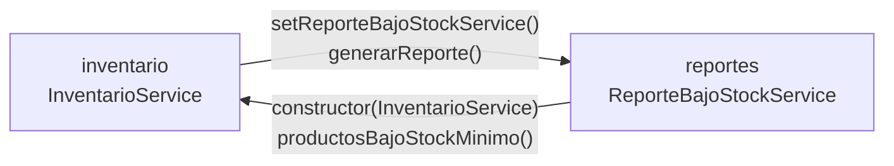
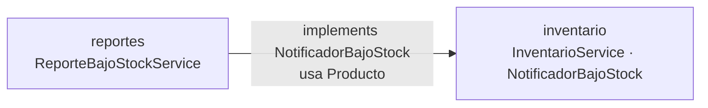

# Refactorización guiada por pruebas: code smells, paquetes y acoplamiento

Post-contenido de la Unidad 11 de Patrones de Diseño de Software. Proyecto Spring Boot 3.5
(Java 17) con un servicio de inventario que nace con dos code smells reales. Primero se
blinda con pruebas de caracterización y después se refactoriza, eligiendo la técnica de
Fowler para cada smell y verificando con las mismas pruebas que el comportamiento
observable no cambia. Luego se agrega un módulo de reportes que introduce un ciclo entre
paquetes, se diagnostica con ArchUnit y se resuelve invirtiendo la dependencia.

| Resultado | Antes | Después |
|---|---|---|
| `actualizarInventario()` | 44 líneas, complejidad 12 | 8 líneas, complejidad 2 |
| `switch` sobre `TipoProducto` | 2 duplicados | 0 |
| Ciclo `inventario ↔ reportes` | ArchUnit en rojo, la app no arranca | ArchUnit en verde, la app arranca |
| Pruebas de caracterización | 20 en verde | Las mismas 20, sin modificar, en verde |

## Decisiones de diseño
1. **Cálculo de reorden como método privado**, no clase propia: es una línea estable sin
   variantes. [Detalle](#refactorización-1-long-method)
2. **Enum con métodos abstractos** en lugar de una interfaz de estrategia: el conjunto de
   tipos es cerrado y el compilador garantiza que ninguno quede sin implementar.
   [Detalle](#refactorización-2-switch-statements-duplicados)
3. **`NotificadorBajoStock` en `inventario`**: el dominio define la abstracción y el paquete
   consumidor la implementa. [Detalle](#resolución-inversión-de-dependencias)
4. **Notificación por evento** (`notificar(Producto, int)`): entrega la cantidad de reorden
   ya calculada y en el momento en que ocurre. [Detalle](#resolución-inversión-de-dependencias)

# Parte 1 — Red de seguridad y refactorización guiada por evidencia

## Code smells encontrados

Las métricas se tomaron con [lizard](https://github.com/terryyin/lizard) (líneas y
complejidad ciclomática por método) sobre el código original del primer commit.

**1. Long Method (Bloater) en `InventarioService.actualizarInventario()`.** El método
ocupaba 44 líneas (32 de código efectivo), con complejidad ciclomática 12, y mezclaba cinco
responsabilidades en un solo bloque:

| Responsabilidad | Líneas del original |
|---|---|
| Validación de entrada | 21–25 |
| Búsqueda del producto | 27–32 |
| Actualización de stock | 34–42 |
| Cálculo de la cantidad de reorden | 44–47 |
| Registro del movimiento y decisión de alerta | 49–61 |

**2. Switch Statements duplicados en `ClasificadorProducto` y `EtiquetadoProducto`.** Las
dos clases tenían el mismo `switch (producto.getTipo())` con las mismas cuatro ramas
(LIBRO, ELECTRONICO, ROPA, ALIMENTO) en sus líneas 7 a 11; solo cambiaba lo que se
calculaba dentro de cada rama. Eran 10 líneas de estructura repetida (2 `switch` y 8
`case`), y agregar un tipo de producto obligaba a modificar tres archivos: el enum y las dos
clases, con el riesgo de olvidar una.

## Red de seguridad: pruebas de caracterización

Las pruebas se escribieron y se ejecutaron en verde **sobre el código original**, antes de
modificar una sola línea (commit `test: agregar pruebas de caracterizacion...`). Se instancian
directamente con `new`, sin levantar Spring, para que sean rápidas. Además de las del
enunciado, se agregaron casos que la red necesitaba:

- **`EtiquetadoProductoTest` cubre las cuatro ramas.** El enunciado solo traía LIBRO y
  ELECTRONICO; sin ROPA y ALIMENTO, el refactor del `switch` podía romper dos ramas sin que
  ninguna prueba lo notara.
- **Casos límite de `actualizarInventario`:** stock que queda exactamente en el mínimo (no
  reordena, porque la condición es "menor que"), stock que queda en cero (es válido y
  reordena 15), cantidad cero e id nulo (datos inválidos), y reorden disparada por una
  ENTRADA.
- **Un comportamiento sospechoso, documentado tal cual.** Una ENTRADA con cantidad
  negativa resta stock sin validar: 20 + (−30) deja el stock en −10. La prueba
  `entrada_conCantidadNegativa_restaStockSinValidar` fija ese comportamiento para que el
  refactor lo preserve. Corregirlo sería un cambio de comportamiento aparte, que no le
  corresponde a una refactorización.

| Clase de prueba | Casos | Cubre |
|---|---|---|
| `InventarioServiceTest` | 12 | Los cuatro resultados (OK, datos inválidos, stock insuficiente, reorden) más el producto inexistente y los límites |
| `ClasificadorProductoTest` | 4 | Las cuatro ramas del recargo |
| `EtiquetadoProductoTest` | 4 | Las cuatro ramas de la etiqueta |

## Refactorización 1: Long Method

**Técnicas aplicadas: Extract Method**, para cada responsabilidad, más **Replace Loop with
Pipeline** en la búsqueda (el `for` con `break` pasó a un `stream().filter().findFirst()`).
También se aplicó **Replace Magic Literal** para `"ENTRADA"`, `"SALIDA"` y el factor 3 de
reorden. `actualizarInventario()` ahora se lee como una narración: valida, busca el
producto y aplica el movimiento.

```java
public String actualizarInventario(Long productoId, int cantidad, String tipoMovimiento) {
    if (!sonDatosValidos(productoId, cantidad, tipoMovimiento)) {
        return "ERROR_DATOS_INVALIDOS";
    }
    return buscarProducto(productoId)
            .map(producto -> aplicarMovimiento(producto, cantidad, tipoMovimiento))
            .orElse("ERROR_PRODUCTO_NO_EXISTE");
}
```

| Responsabilidad | Método extraído |
|---|---|
| Validación de entrada | `sonDatosValidos` |
| Búsqueda del producto | `buscarProducto` (devuelve `Optional<Producto>`) |
| Actualización de stock | `calcularNuevoStock`, `esStockInsuficiente` |
| Cálculo de reorden | `necesitaReorden`, `calcularCantidadReorden` |
| Registro y alerta | `registrarMovimiento`, `emitirAlertaDeReorden` |
| Coordinación del movimiento | `aplicarMovimiento`, `resultadoDelMovimiento` |

| Métrica de `actualizarInventario()` | Antes | Después |
|---|---|---|
| Líneas | 44 | 8 |
| Complejidad ciclomática | 12 | 2 |
| Responsabilidades | 5 | 1 (coordinar) |
| Método más complejo de la clase | 12 | 4 (`sonDatosValidos`) |

Un detalle que las pruebas obligaron a respetar: el error de stock insuficiente solo
aplica a una SALIDA (`esStockInsuficiente` revisa el tipo), igual que en el original. Si se
hubiera validado `nuevoStock < 0` para cualquier movimiento, el refactor habría cambiado el
caso de la ENTRADA negativa, y la prueba de caracterización lo habría detectado.

**Decisión de diseño 1 — el cálculo de reorden queda como método privado
(`calcularCantidadReorden`), no como clase `CalculadoraReorden`.** Es una sola expresión
(`stockMinimo × 3 − stock`), sin colaboradores ni variantes, y su único consumidor es este
servicio. Hoy no tiene una razón de cambio distinta del resto del flujo de inventario.
Extraer una clase ahora agregaría una inyección y un archivo más para una línea de lógica,
sin que exista un segundo caso que lo justifique. La señal para reconsiderarlo sería que la
política de reorden empiece a variar (por tipo de producto, por proveedor o por
temporada); ahí tendría una razón de cambio propia y merecería su propia clase.

## Refactorización 2: Switch Statements duplicados

**Técnica aplicada: Replace Conditional with Polymorphism.** `TipoProducto` declara un
método abstracto por comportamiento (`recargoEnvio(double precio)` y
`etiqueta(String nombre)`) y cada constante lo implementa. Las dos clases quedaron en una
línea y conservan exactamente sus firmas:

```java
public double calcularRecargoEnvio(Producto producto) {
    return producto.getTipo().recargoEnvio(producto.getPrecio());
}

public String generarEtiqueta(Producto producto) {
    return producto.getTipo().etiqueta(producto.getNombre());
}
```

| Evidencia | Antes | Después |
|---|---|---|
| `switch` sobre `TipoProducto` en el código | 2 | 0 |
| Líneas `case` repetidas | 8 | 0 |
| Complejidad de `calcularRecargoEnvio` / `generarEtiqueta` | 5 / 5 | 1 / 1 |
| Archivos a modificar para agregar un tipo | 3 | 1 (`TipoProducto`) |

Los métodos reciben el precio y el nombre, y no el `Producto` completo, para que el enum no
dependa de la clase que lo contiene. Al agregar un tipo nuevo, el compilador obliga a
implementar ambos métodos, así que ya no es posible olvidarse de uno.

**Decisión de diseño 2 — enum con métodos abstractos, no interfaz de estrategia con una
clase por tipo.** El conjunto de tipos es cerrado y estable en este dominio, y los
comportamientos son cálculos puros sin dependencias. Con el enum, cada tipo y todas sus
reglas viven en un solo lugar, el compilador garantiza que ningún tipo quede sin
implementar, y no hace falta una jerarquía de cuatro clases más un mecanismo de selección.
El costo es la rigidez: las constantes de un enum no pueden recibir colaboradores
inyectados por Spring. Si en el futuro un tipo necesitara, por ejemplo, consultar un
servicio de tarifas, habría que migrar a una interfaz `ReglasPorTipo` con un `@Component`
por tipo y un selector. Hoy esa necesidad no existe.

## Verificación de que el comportamiento no cambió

| Momento | `mvn test` |
|---|---|
| Código original (pruebas recién escritas) | 20 pruebas, 0 fallos |
| Tras la refactorización 1 (Long Method) | 20 pruebas, 0 fallos |
| Tras la refactorización 2 (switch) | 20 pruebas, 0 fallos |

Ninguna prueba se modificó después del commit de caracterización (`git diff` sobre
`src/test` vacío en ambos commits de refactor). Como verificación adicional, cada versión
se comparó contra el código original, ejecutando ambas con las mismas entradas:

- **`InventarioService`:** 7 500 llamadas en secuencias aleatorias, incluidos ids nulos o
  inexistentes, tipos de movimiento inválidos y cantidades negativas, cero y mayores que el
  stock. Se obtuvo el mismo valor de retorno, la misma salida por consola, el mismo stock y
  el mismo registro de movimientos en el 100% de los casos.
- **`ClasificadorProducto` y `EtiquetadoProducto`:** 128 combinaciones de tipo, precio y
  nombre (incluido un nombre nulo) con resultados idénticos. Con tipo nulo, ambas versiones
  lanzan `NullPointerException`.

# Parte 2 — Diagnóstico y resolución de acoplamiento entre paquetes

## Diagnóstico: ciclo entre `inventario` y `reportes`

Para que `InventarioService` avisara al módulo de reportes al detectar bajo stock, se le
agregó un colaborador opcional por setter (`setReporteBajoStockService`), invocado en la rama
de reorden. A su vez, `ReporteBajoStockService` recibe `InventarioService` por constructor
para recorrer los productos bajo el mínimo (`productosBajoStockMinimo()`). Cada paquete
depende del otro:



```
  inventario  ───── importa ReporteBajoStockService ─────▶  reportes
      ▲                                                        │
      └───────────── importa InventarioService, Producto ──────┘
```

El código compila y las 20 pruebas de caracterización siguen en verde, porque el problema
es de arquitectura y no de comportamiento. La prueba de arquitectura
`ArquitecturaPaquetesTest` (ArchUnit, regla `slices().should().beFreeOfCycles()`) sí lo
detecta y falla:

```
Architecture Violation [Priority: MEDIUM] - Rule 'slices matching
'com.universidad.refactoringu11.(*)..' should be free of cycles' was violated (1 times):
Cycle detected: Slice inventario ->
  1. Dependencies of Slice inventario
    - Field <InventarioService.reporteBajoStockService> has type <ReporteBajoStockService>
    - Method <InventarioService.setReporteBajoStockService(ReporteBajoStockService)> has parameter of type <ReporteBajoStockService>
    - Method <InventarioService.resultadoDelMovimiento(Producto)> calls method <ReporteBajoStockService.generarReporte()>
  2. Dependencies of Slice reportes
    - Constructor <ReporteBajoStockService.<init>(InventarioService)> has parameter of type <InventarioService>
    - Method <ReporteBajoStockService.generarReporte()> calls method <InventarioService.productosBajoStockMinimo()>
    - Method <ReporteBajoStockService.generarReporte()> calls method <Producto.getNombre()> (y getStock, getStockMinimo)

Tests run: 1, Failures: 1, Errors: 0, Skipped: 0
```

**El ciclo de paquetes también es un ciclo de objetos.** Las pruebas de caracterización no lo
ven porque instancian `InventarioService` con `new`, pero al arrancar la aplicación con
`./mvnw spring-boot:run` Spring Boot no puede construir los beans:

```
APPLICATION FAILED TO START

The dependencies of some of the beans in the application context form a cycle:
┌─────┐
|  inventarioService
↑     ↓
|  reporteBajoStockService
└─────┘
```

Que el `@Autowired(required = false)` vuelva opcional al colaborador no evita el problema: en
cuanto el bean existe, Spring intenta inyectarlo, y para crearlo necesita el
`InventarioService` que todavía está en construcción.

## Resolución: inversión de dependencias

Se extrajo la interfaz `NotificadorBajoStock` en el paquete `inventario`.
`InventarioService` depende solo de ella (`setNotificador(NotificadorBajoStock)`) y ya no
importa nada de `reportes`. `ReporteBajoStockService` la implementa, de modo que la única
dependencia entre paquetes queda en la dirección `reportes → inventario`:

```java
// inventario
@FunctionalInterface
public interface NotificadorBajoStock {
    void notificar(Producto producto, int cantidadReorden);
}

// reportes
@Service
public class ReporteBajoStockService implements NotificadorBajoStock { ... }
```



```
  inventario  (InventarioService ──usa──▶ «interface» NotificadorBajoStock)
      ▲
      └──────── reportes  (ReporteBajoStockService implements NotificadorBajoStock)
```

**El reporte pasó de consultar a recibir avisos.** En el código del enunciado,
`ReporteBajoStockService` seguía recibiendo `InventarioService` por constructor. Así se
rompe el ciclo entre paquetes, pero no el de objetos: Spring tendría que inyectar en
`inventarioService` un notificador que a su vez necesita `inventarioService`, y la
aplicación seguiría sin arrancar. Como ahora el reporte recibe cada alerta en `notificar()`
(guarda nombre, stock, mínimo y cantidad a reordenar del momento), ya no necesita
consultar al inventario. Se quitaron esa dependencia y el método
`productosBajoStockMinimo()`, que quedaba sin uso.

**Resultado de `ArquitecturaPaquetesTest` después del cambio:**
```
$ ./mvnw test -Dtest=ArquitecturaPaquetesTest
[INFO] Tests run: 1, Failures: 0, Errors: 0, Skipped: 0
[INFO] BUILD SUCCESS
```

**El comportamiento observable no cambió.** Las 20 pruebas de caracterización de la Parte 1
se ejecutaron sin modificar una sola línea: `git diff` sobre
`src/test/java/.../inventario/InventarioServiceTest.java`, `ClasificadorProductoTest.java` y
`EtiquetadoProductoTest.java` está vacío desde su commit original. Además, la aplicación
vuelve a arrancar (`Started RefactoringU11Application in 0.497 seconds`).

| Momento | ArchUnit | Caracterización (20) | `spring-boot:run` |
|---|---|---|---|
| Tras agregar `reportes` | Falla: ciclo `inventario ↔ reportes` | Verde | No arranca: ciclo de beans |
| Tras invertir la dependencia | Verde | Verde, sin modificar | Arranca |

**Pruebas nuevas para el comportamiento nuevo.** La notificación y el reporte no existían en
la Parte 1, así que se probaron en archivos nuevos, sin tocar los de caracterización:

| Prueba | Qué verifica |
|---|---|
| `InventarioServiceNotificacionTest` (3) | Se notifica el producto y la cantidad de reorden correcta, y no se notifica cuando no hay bajo stock o la salida falla. Usa un lambda como doble, porque la interfaz es funcional |
| `ReporteBajoStockServiceTest` (3) | Reporte vacío, varias alertas en orden, y que el reporte conserve el stock del momento de la alerta |
| `InventarioReportesIntegracionTest` (1) | Con el contexto real de Spring, la alerta llega al reporte. Se comprobó que esta prueba falla contra el commit con el ciclo (`BeanCurrentlyInCreationException`) |

Suite final: **28 pruebas, 0 fallos** (20 de caracterización, 1 de arquitectura y 7 del
comportamiento nuevo).

**Decisión de diseño 3 — `NotificadorBajoStock` vive en `inventario` y no en `reportes`.**
`inventario` es el dominio: contiene las reglas de negocio (stock, reorden, tipos de
producto) y es el paquete de mayor nivel de abstracción. `reportes` es un consumidor que
presenta información, más cercano a la infraestructura. Siguiendo la regla de la Sección 4.3
de la guía ("los paquetes de infraestructura dependen de dominio; dominio nunca depende de
infraestructura"), la abstracción la define quien la necesita: inventario declara "necesito
avisar que un producto quedó bajo el mínimo" sin saber quién escucha. Si la interfaz
estuviera en `reportes`, `InventarioService` tendría que importarla desde ahí y el ciclo
seguiría existiendo (inventario → reportes por la interfaz y reportes → inventario por
`Producto`). Además, así mañana se puede agregar otro notificador (correo, compras) sin
tocar inventario.

**Decisión de diseño 4 — notificación por evento: `notificar(Producto, int cantidadReorden)`.**
En este diseño la alerta nace de un movimiento puntual sobre un solo producto, en el mismo
instante en que `InventarioService` calcula la cantidad a reordenar. Notificar por evento:

- **Entrega el dato ya calculado.** La política de reorden (mínimo × 3 − stock) queda en el
  dominio y el reporte no la recalcula ni la duplica.
- **Es inmediato y no obliga a inventario a acumular nada**: no necesita una lista de
  pendientes ni decidir cuándo vaciarla.
- **Deja una interfaz de un solo método.** Es funcional, se implementa con un lambda en las
  pruebas y cualquier nuevo consumidor la implementa trivialmente.

Una notificación por lote (`notificar(List<Producto>)`) sería preferible si los avisos se
consumieran de forma consolidada: un resumen diario por correo, un proceso nocturno o una
carga masiva de inventario que mueve cientos de productos a la vez. En esos casos, mandar un
aviso por producto generaría ruido o llamadas excesivas a un sistema externo. Hoy cada
movimiento afecta a un solo producto y el reporte se consulta bajo demanda, así que el lote
no aporta nada.

## Ajustes respecto al código del enunciado
- **Spring Boot 3.5.16.** Spring Initializr ya solo ofrece Boot 4, que trae JUnit 6. El
  prerrequisito pide JUnit 5 incluido en `spring-boot-starter-test`, así que se fijó el
  último parche de la línea 3.x.
- **`EtiquetadoProductoTest` con las cuatro ramas.** El enunciado traía solo LIBRO y
  ELECTRONICO, pero su propio checkpoint exige cubrir las cuatro ramas en ambas clases.
- **Casos límite adicionales** en `InventarioServiceTest` (ver Parte 1).
- **`ReporteBajoStockService` sin dependencia de `InventarioService`** tras la inversión,
  para eliminar el ciclo de beans que impedía arrancar la aplicación.
- **Conteo de pruebas.** El enunciado anuncia `Tests run: 12` en el Paso 4, pero sus propias
  pruebas suman 12 de caracterización más la de arquitectura (13). Aquí el total es 28 por
  los casos agregados y las pruebas del comportamiento nuevo.
- **Commit en rojo intencional.** El commit
  `test: agregar prueba de arquitectura que detecta ciclo... (en rojo)` deja
  `ArquitecturaPaquetesTest` fallando a propósito, como pide el Paso 2, para documentar el
  diagnóstico antes de resolverlo. Todos los demás commits pasan `./mvnw test` en verde.

## Ejecutar las pruebas
```bash
./mvnw test                                   # Suite completa (28 pruebas)
./mvnw test -Dtest=ArquitecturaPaquetesTest   # Solo la prueba de arquitectura
./mvnw spring-boot:run                        # Verifica que el contexto arranca
```

## Herramientas utilizadas
- Java 17, Spring Boot 3.5, JUnit 5, ArchUnit 1.3
- Apache Maven, lizard (métricas de líneas y complejidad), Git, GitHub

## Conclusiones
Escribir las pruebas de caracterización antes de tocar el código fue lo que hizo posible
refactorizar con confianza: además de proteger los casos obvios, obligaron a preservar un
comportamiento sospechoso (la entrada negativa) que un refactor "intuitivo" habría cambiado
sin querer. Las técnicas de Fowler se eligieron por lo que pedía cada smell: Extract Method
redujo `actualizarInventario()` de 44 líneas y complejidad 12 a 8 líneas y complejidad 2, y
Replace Conditional with Polymorphism dejó en un solo archivo lo que antes había que cambiar
en tres. En la Parte 2 quedó claro que un code smell no es un bug: el ciclo entre paquetes
compilaba y pasaba todas las pruebas de negocio, y solo una prueba de arquitectura lo hizo
visible. También quedó claro que invertir la dependencia entre paquetes no basta si el grafo
de objetos sigue siendo circular; por eso el reporte pasó a recibir eventos en lugar de
consultar al inventario, y una prueba de integración con Spring protege ahora ese límite.
