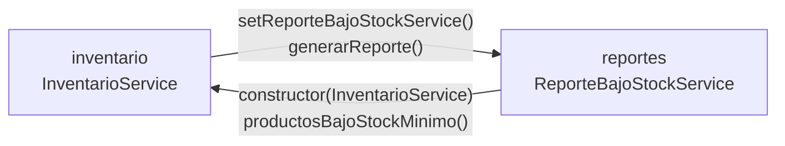

# Refactorización guiada por pruebas: code smells, paquetes y acoplamiento

Post-contenido de la Unidad 11 de Patrones de Diseño de Software. Proyecto Spring Boot 3.5
(Java 17) con un servicio de inventario que nace con dos code smells reales. Primero se
blinda con pruebas de caracterización y después se refactoriza, eligiendo la técnica de
Fowler para cada smell y verificando con las mismas pruebas que el comportamiento
observable no cambia.

# Parte 1 — Red de seguridad y refactorización guiada por evidencia

## Code smells encontrados

Las métricas se tomaron con [lizard](https://github.com/terryyin/lizard) (líneas y
complejidad ciclomática por método) sobre el código original del primer commit.

**1. Long Method (Bloater) en `InventarioService.actualizarInventario()`.** El método
ocupaba 44 líneas (32 de código efectivo), con complejidad ciclomática 12, y mezclaba cinco
responsabilidades en un solo bloque:

| Responsabilidad | Líneas del original |
|---|---|
| Validación de entrada | 21–25 |
| Búsqueda del producto | 27–32 |
| Actualización de stock | 34–42 |
| Cálculo de la cantidad de reorden | 44–47 |
| Registro del movimiento y decisión de alerta | 49–61 |

**2. Switch Statements duplicados en `ClasificadorProducto` y `EtiquetadoProducto`.** Las
dos clases tenían el mismo `switch (producto.getTipo())` con las mismas cuatro ramas
(LIBRO, ELECTRONICO, ROPA, ALIMENTO) en sus líneas 7 a 11; solo cambiaba lo que se
calculaba dentro de cada rama. Eran 10 líneas de estructura repetida (2 `switch` y 8
`case`), y agregar un tipo de producto obligaba a modificar tres archivos: el enum y las dos
clases, con el riesgo de olvidar una.

## Red de seguridad: pruebas de caracterización

Las pruebas se escribieron y se ejecutaron en verde **sobre el código original**, antes de
modificar una sola línea (commit `test: agregar pruebas de caracterizacion...`). Se instancian
directamente con `new`, sin levantar Spring, para que sean rápidas. Además de las del
enunciado, se agregaron casos que la red necesitaba:

- **`EtiquetadoProductoTest` cubre las cuatro ramas.** El enunciado solo traía LIBRO y
  ELECTRONICO; sin ROPA y ALIMENTO, el refactor del `switch` podía romper dos ramas sin que
  ninguna prueba lo notara.
- **Casos límite de `actualizarInventario`:** stock que queda exactamente en el mínimo (no
  reordena, porque la condición es "menor que"), stock que queda en cero (es válido y
  reordena 15), cantidad cero e id nulo (datos inválidos), y reorden disparada por una
  ENTRADA.
- **Un comportamiento sospechoso, documentado tal cual.** Una ENTRADA con cantidad
  negativa resta stock sin validar: 20 + (−30) deja el stock en −10. La prueba
  `entrada_conCantidadNegativa_restaStockSinValidar` fija ese comportamiento para que el
  refactor lo preserve. Corregirlo sería un cambio de comportamiento aparte, que no le
  corresponde a una refactorización.

| Clase de prueba | Casos | Cubre |
|---|---|---|
| `InventarioServiceTest` | 12 | Los cuatro resultados (OK, datos inválidos, stock insuficiente, reorden) más el producto inexistente y los límites |
| `ClasificadorProductoTest` | 4 | Las cuatro ramas del recargo |
| `EtiquetadoProductoTest` | 4 | Las cuatro ramas de la etiqueta |

## Refactorización 1: Long Method

**Técnicas aplicadas: Extract Method**, para cada responsabilidad, más **Replace Loop with
Pipeline** en la búsqueda (el `for` con `break` pasó a un `stream().filter().findFirst()`).
También se aplicó **Replace Magic Literal** para `"ENTRADA"`, `"SALIDA"` y el factor 3 de
reorden. `actualizarInventario()` ahora se lee como una narración: valida, busca el
producto y aplica el movimiento.

```java
public String actualizarInventario(Long productoId, int cantidad, String tipoMovimiento) {
    if (!sonDatosValidos(productoId, cantidad, tipoMovimiento)) {
        return "ERROR_DATOS_INVALIDOS";
    }
    return buscarProducto(productoId)
            .map(producto -> aplicarMovimiento(producto, cantidad, tipoMovimiento))
            .orElse("ERROR_PRODUCTO_NO_EXISTE");
}
```

| Responsabilidad | Método extraído |
|---|---|
| Validación de entrada | `sonDatosValidos` |
| Búsqueda del producto | `buscarProducto` (devuelve `Optional<Producto>`) |
| Actualización de stock | `calcularNuevoStock`, `esStockInsuficiente` |
| Cálculo de reorden | `necesitaReorden`, `calcularCantidadReorden` |
| Registro y alerta | `registrarMovimiento`, `emitirAlertaDeReorden` |
| Coordinación del movimiento | `aplicarMovimiento`, `resultadoDelMovimiento` |

| Métrica de `actualizarInventario()` | Antes | Después |
|---|---|---|
| Líneas | 44 | 8 |
| Complejidad ciclomática | 12 | 2 |
| Responsabilidades | 5 | 1 (coordinar) |
| Método más complejo de la clase | 12 | 4 (`sonDatosValidos`) |

Un detalle que las pruebas obligaron a respetar: el error de stock insuficiente solo
aplica a una SALIDA (`esStockInsuficiente` revisa el tipo), igual que en el original. Si se
hubiera validado `nuevoStock < 0` para cualquier movimiento, el refactor habría cambiado el
caso de la ENTRADA negativa, y la prueba de caracterización lo habría detectado.

**Decisión de diseño 1 — el cálculo de reorden queda como método privado
(`calcularCantidadReorden`), no como clase `CalculadoraReorden`.** Es una sola expresión
(`stockMinimo × 3 − stock`), sin colaboradores ni variantes, y su único consumidor es este
servicio. Hoy no tiene una razón de cambio distinta del resto del flujo de inventario.
Extraer una clase ahora agregaría una inyección y un archivo más para una línea de lógica,
sin que exista un segundo caso que lo justifique. La señal para reconsiderarlo sería que la
política de reorden empiece a variar (por tipo de producto, por proveedor o por
temporada); ahí tendría una razón de cambio propia y merecería su propia clase.

## Refactorización 2: Switch Statements duplicados

**Técnica aplicada: Replace Conditional with Polymorphism.** `TipoProducto` declara un
método abstracto por comportamiento (`recargoEnvio(double precio)` y
`etiqueta(String nombre)`) y cada constante lo implementa. Las dos clases quedaron en una
línea y conservan exactamente sus firmas:

```java
public double calcularRecargoEnvio(Producto producto) {
    return producto.getTipo().recargoEnvio(producto.getPrecio());
}

public String generarEtiqueta(Producto producto) {
    return producto.getTipo().etiqueta(producto.getNombre());
}
```

| Evidencia | Antes | Después |
|---|---|---|
| `switch` sobre `TipoProducto` en el código | 2 | 0 |
| Líneas `case` repetidas | 8 | 0 |
| Complejidad de `calcularRecargoEnvio` / `generarEtiqueta` | 5 / 5 | 1 / 1 |
| Archivos a modificar para agregar un tipo | 3 | 1 (`TipoProducto`) |

Los métodos reciben el precio y el nombre, y no el `Producto` completo, para que el enum no
dependa de la clase que lo contiene. Al agregar un tipo nuevo, el compilador obliga a
implementar ambos métodos, así que ya no es posible olvidarse de uno.

**Decisión de diseño 2 — enum con métodos abstractos, no interfaz de estrategia con una
clase por tipo.** El conjunto de tipos es cerrado y estable en este dominio, y los
comportamientos son cálculos puros sin dependencias. Con el enum, cada tipo y todas sus
reglas viven en un solo lugar, el compilador garantiza que ningún tipo quede sin
implementar, y no hace falta una jerarquía de cuatro clases más un mecanismo de selección.
El costo es la rigidez: las constantes de un enum no pueden recibir colaboradores
inyectados por Spring. Si en el futuro un tipo necesitara, por ejemplo, consultar un
servicio de tarifas, habría que migrar a una interfaz `ReglasPorTipo` con un `@Component`
por tipo y un selector. Hoy esa necesidad no existe.

## Verificación de que el comportamiento no cambió

| Momento | `mvn test` |
|---|---|
| Código original (pruebas recién escritas) | 20 pruebas, 0 fallos |
| Tras la refactorización 1 (Long Method) | 20 pruebas, 0 fallos |
| Tras la refactorización 2 (switch) | 20 pruebas, 0 fallos |

Ninguna prueba se modificó después del commit de caracterización (`git diff` sobre
`src/test` vacío en ambos commits de refactor). Como verificación adicional, cada versión
se comparó contra el código original, ejecutando ambas con las mismas entradas:

- **`InventarioService`:** 7 500 llamadas en secuencias aleatorias, incluidos ids nulos o
  inexistentes, tipos de movimiento inválidos y cantidades negativas, cero y mayores que el
  stock. Se obtuvo el mismo valor de retorno, la misma salida por consola, el mismo stock y
  el mismo registro de movimientos en el 100% de los casos.
- **`ClasificadorProducto` y `EtiquetadoProducto`:** 128 combinaciones de tipo, precio y
  nombre (incluido un nombre nulo) con resultados idénticos. Con tipo nulo, ambas versiones
  lanzan `NullPointerException`.

# Parte 2 — Diagnóstico y resolución de acoplamiento entre paquetes

## Diagnóstico: ciclo entre `inventario` y `reportes`

Para que `InventarioService` avisara al módulo de reportes al detectar bajo stock, se le
agregó un colaborador opcional por setter (`setReporteBajoStockService`), invocado en la rama
de reorden. A su vez, `ReporteBajoStockService` recibe `InventarioService` por constructor
para recorrer los productos bajo el mínimo (`productosBajoStockMinimo()`). Cada paquete
depende del otro:



```
  inventario  ───── importa ReporteBajoStockService ─────▶  reportes
      ▲                                                        │
      └───────────── importa InventarioService, Producto ──────┘
```

El código compila y las 20 pruebas de caracterización siguen en verde, porque el problema
es de arquitectura y no de comportamiento. La prueba de arquitectura
`ArquitecturaPaquetesTest` (ArchUnit, regla `slices().should().beFreeOfCycles()`) sí lo
detecta y falla:

```
Architecture Violation [Priority: MEDIUM] - Rule 'slices matching
'com.universidad.refactoringu11.(*)..' should be free of cycles' was violated (1 times):
Cycle detected: Slice inventario ->
  1. Dependencies of Slice inventario
    - Field <InventarioService.reporteBajoStockService> has type <ReporteBajoStockService>
    - Method <InventarioService.setReporteBajoStockService(ReporteBajoStockService)> has parameter of type <ReporteBajoStockService>
    - Method <InventarioService.resultadoDelMovimiento(Producto)> calls method <ReporteBajoStockService.generarReporte()>
  2. Dependencies of Slice reportes
    - Constructor <ReporteBajoStockService.<init>(InventarioService)> has parameter of type <InventarioService>
    - Method <ReporteBajoStockService.generarReporte()> calls method <InventarioService.productosBajoStockMinimo()>
    - Method <ReporteBajoStockService.generarReporte()> calls method <Producto.getNombre()> (y getStock, getStockMinimo)

Tests run: 1, Failures: 1, Errors: 0, Skipped: 0
```

**El ciclo de paquetes también es un ciclo de objetos.** Las pruebas de caracterización no lo
ven porque instancian `InventarioService` con `new`, pero al arrancar la aplicación con
`./mvnw spring-boot:run` Spring Boot no puede construir los beans:

```
APPLICATION FAILED TO START

The dependencies of some of the beans in the application context form a cycle:
┌─────┐
|  inventarioService
↑     ↓
|  reporteBajoStockService
└─────┘
```

Que el `@Autowired(required = false)` vuelva opcional al colaborador no evita el problema: en
cuanto el bean existe, Spring intenta inyectarlo, y para crearlo necesita el
`InventarioService` que todavía está en construcción.

## Ejecutar las pruebas
```bash
./mvnw test
```
